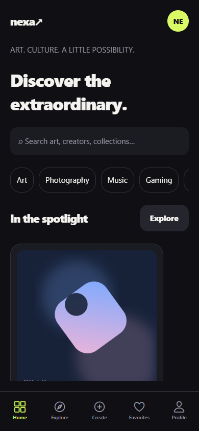
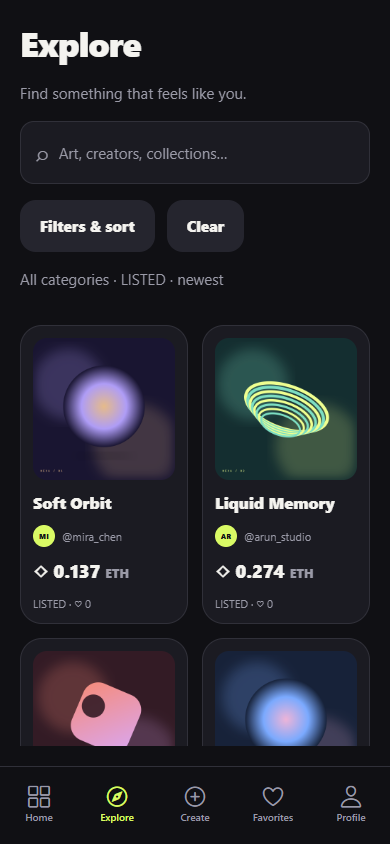
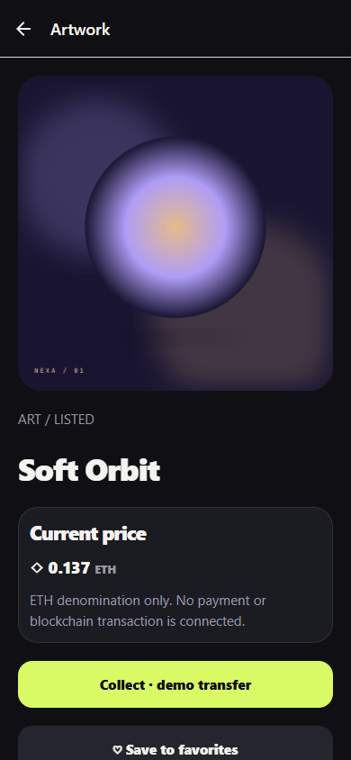
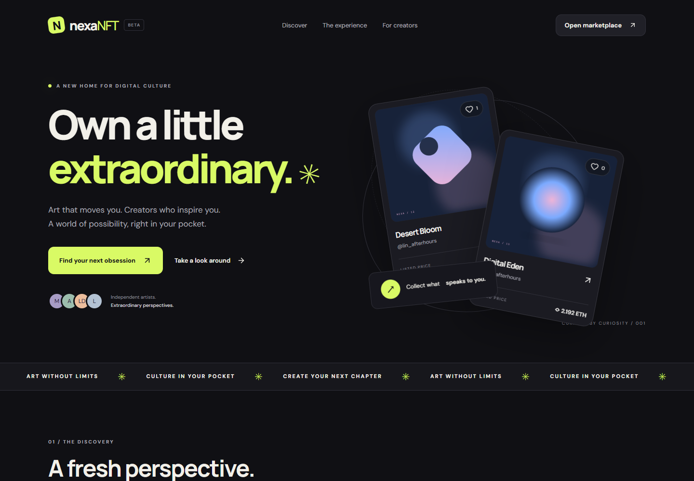
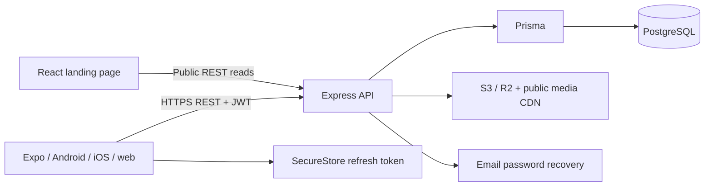
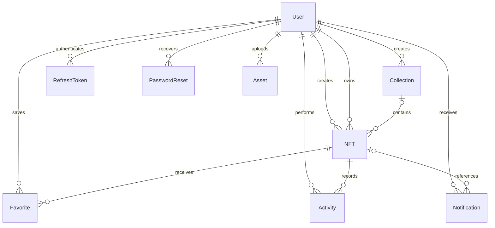

# NexaNFT

**Made by Lakshay Dhiman**

A full-stack digital-art marketplace for Android and iOS, built with React Native, Expo, TypeScript, Express, and PostgreSQL. The responsive landing page and Expo web preview share the app’s dark, lime-accented visual language.

**This is a conventional platform marketplace.** Ownership is recorded in PostgreSQL. ETH is a display denomination. The optional, explicitly acknowledged demo transfer updates platform records; it never processes payment, mints an NFT, or transfers blockchain ownership. Demo transfers are disabled by default in production.

## Features

- Registration, login, logout, persisted mobile sessions, access-token expiration handling, rotating refresh tokens, replay detection, and single-use password recovery.
- Browse/search artwork by name, creator, collection, and category; filter by status and price; sort chronologically, numerically, or by favorites.
- Paginated home/explore feeds, collections, creator profiles, private favorites, owned and created works.
- Validated artwork, avatar, and collection-cover uploads; local development storage and a production S3-compatible adapter.
- Create, edit, unlist, relist, and remove owned listings, with authorization enforced by the API.
- Atomic demo transfers, marketplace activity, persistent private notifications, and optional device-local confirmations.
- Profile editing, onboarding, recovery, settings, loading skeletons, retry/empty/error states, and failed-image fallbacks.
- API-backed responsive landing page, genuine application screenshots, meaningful automated tests, CI, and deployment configurations.

## Screenshots

The screenshots are captured from the actual Expo web application using the PostgreSQL-backed API. They are representative previews, not proof of native device testing.

| Home                               | Explore                                  | Artwork detail                         |
| ---------------------------------- | ---------------------------------------- | -------------------------------------- |
|  |  |  |



## Architecture



## Technology stack

| Layer           | Stack                                                                                             |
| --------------- | ------------------------------------------------------------------------------------------------- |
| Mobile          | Expo SDK 55, React Native 0.83, React 19.2, Expo Router, TypeScript                               |
| Forms and state | React Hook Form, Zod, Zustand, TanStack Query                                                     |
| Mobile platform | Expo Image, Image Picker, SecureStore, Notifications, AsyncStorage                                |
| API             | Node.js 22+, Express 5, Prisma 6, JWT, bcrypt, Helmet, CORS, rate limiting, Pino                  |
| Persistence     | PostgreSQL, indexed relational models and checked-in SQL migration                                |
| Images          | Sharp decoding/re-encoding, local files in development, S3-compatible cloud storage in production |
| Landing         | React, Vite, responsive CSS, Lucide icons                                                         |
| Tests           | Vitest, Supertest, PostgreSQL integration tests, Testing Library, Playwright workflows            |

## Repository and mobile architecture

```text
mobile/
  app/                 Expo Router tabs, authentication, and nested screens
  components/          Cards, controls, images, states, filter sheet, auth gate
  features/            Auth, marketplace, listings, activity
  hooks/               Query hooks and debounce
  services/            HTTP, refresh controller, secure storage, uploads, local alerts
  store/               Small auth and search stores
  constants/           Design tokens
  assets/              App icon and splash artwork
server/
  prisma/              Schema, SQL migration, development seed
  src/
    routes/            HTTP routing and boundary middleware
    controllers/       Parse inputs and construct standardized responses
    services/          Authentication, marketplace, listings, storage, profiles
    models/            Prisma connection and safe response selectors
    middleware/        Authentication and centralized errors
    validators/        Boundary schemas
    config/            Validated environment
    utils/             Logger, errors, response helpers
    types/             Express request augmentation
  tests/               Integration tests using a separate PostgreSQL database
packages/contracts/    Shared types and validation schemas; compiled server package
landing/               Responsive API-backed landing page
tests/                 Browser workflows
scripts/               Local infrastructure, preview, readiness, guide generation
docs/                  API, deployment, QA, security, implementation evidence
```

The 20 requested screens are implemented: splash, onboarding, login, register, forgot password, home, explore, search, artwork details, collections, collection details, creator profile, favorites, create, my works, activity, notifications, profile, edit profile, and settings. Additional routes support password reset, listing editing, and collection creation.

## Backend architecture

Routes apply access policy and upload limits. Controllers validate input through shared or server-only schemas. Services own transactional behavior. Prisma owns persistence; explicit selectors protect user privacy. A centralized error handler returns useful errors without leaking database internals or stacks.

`GET /health` queries PostgreSQL for readiness. Logs include request IDs and important events. Request query strings, passwords, hashes, authorization headers, and refresh/reset tokens are excluded from logging.

## Database schema



Favorites use the composite `(userId, nftId)` primary key. Decimal prices are persisted precisely and returned as strings. Favorite counts are derived from the relation rather than a drift-prone redundant counter. SQL checks enforce positive prices, valid categories, ETH denomination, and nonnegative views. Foreign keys, ownership/filter/sort indexes, and trigram search indexes are included. Removing a listing soft-deletes it, preserving activity and references.

## API endpoints

All responses use `{ success, data, message, pagination? }` or `{ success: false, message, code, errors?, requestId? }`. List endpoints accept `page` and `limit` (maximum 50). Full request examples and policy details are in [docs/API.md](docs/API.md).

| Area          | Endpoints                                                                                                             |
| ------------- | --------------------------------------------------------------------------------------------------------------------- |
| Auth          | `POST /api/auth/register`, `/login`, `/refresh`, `/logout`, `/forgot-password`, `/reset-password`; `GET /api/auth/me` |
| Users         | `GET /api/users/:id`; `PATCH /api/users/:id`; `GET /api/users/:id/nfts`, `/favorites`; `GET /api/creators`            |
| Artwork       | `GET /api/nfts`, `/api/nfts/:id`; `POST /api/nfts`; `PATCH`, `DELETE /api/nfts/:id`                                   |
| Favorites     | `POST`, `DELETE /api/nfts/:id/favorite`                                                                               |
| Collections   | `GET`, `POST /api/collections`; `GET /api/collections/:id`, `/api/collections/:id/nfts`                               |
| Search        | `GET /api/search`                                                                                                     |
| Activity      | `GET /api/activity`                                                                                                   |
| Notifications | `GET /api/notifications`; `PATCH /api/notifications/read-all`, `/api/notifications/:id/read`                          |
| Images        | `POST /api/uploads` (multipart `image` and `purpose`)                                                                 |
| Demo transfer | `POST /api/nfts/:id/demo-transfer` with `{ "acknowledgeDemo": true }`                                                 |

## Authentication flow

1. Validate credentials and hash passwords with bcrypt (cost 12). Passwords require 12–72 characters, upper/lowercase, a number, and a symbol; the API also rejects passwords over bcrypt’s 72-byte UTF-8 limit.
2. Issue a 15-minute signed access token and a random 30-day refresh token. Persist only the refresh token’s SHA-256 hash on the server.
3. Keep access tokens in memory. Native refresh tokens live in SecureStore with device-only keychain accessibility. Onboarding/preferences use AsyncStorage.
4. Rotate refresh tokens on restoration or a 401 response. The mobile controller coalesces concurrent refresh calls and serializes storage writes/deletion.
5. Consume refresh tokens conditionally in a transaction. Reuse revokes their entire family. Protected requests check both the token version and an active refresh family.
6. Logout revokes the family; password recovery revokes every session. Existing access JWTs become unusable immediately at the API.

The optional web preview uses per-tab `sessionStorage`; it is not equivalent to native SecureStore. If a refresh response is lost after the server consumed the old token, the user must sign in again. This favors replay protection over a permissive grace window. A failed network logout still clears local credentials; server revocation requires connectivity.

## Installation

Prerequisites: Node.js **22.13 or later in the 22/24 LTS lines**, npm, Git, and PostgreSQL 17+ (or Docker). Android/iOS store builds require your Expo and store accounts.

```sh
npm ci
```

Installation compiles shared contracts and generates Prisma Client. Stop a running API before regenerating Prisma Client on Windows, where its native query-engine DLL can be locked.

### Option A: Docker development database

Copy `.env.example` to `.env`, `server/.env.example` to `server/.env`, and the mobile/landing examples to their respective `.env` files. Replace the database password in both database templates, generate a JWT secret, and keep `STORAGE_DRIVER=local` for development.

```sh
npm run infra:up
docker compose exec postgres createdb -U nexanft nexanft_test
npm run db:migrate
npm run db:seed
```

The API template uses PostgreSQL on port 5433. Native device images and API URLs must use your computer’s LAN IP, not `localhost`.

### Option B: Windows with an installed PostgreSQL server binary

The helper initializes a **separate** database cluster on port 55432. It generates local credentials and does not alter an existing PostgreSQL service. It refuses to overwrite `server/.env`.

```powershell
pwsh -NoProfile -File scripts/setup-local.ps1
npm run db:migrate
npm run db:seed
```

Use `-PostgresBin 'PATH_TO_YOUR_POSTGRES_BIN'` if PostgreSQL 18 is installed elsewhere. Restart this isolated instance after a reboot with:

```powershell
& 'C:\Program Files\PostgreSQL\18\bin\pg_ctl.exe' -D 'server\.data\postgres' -l 'server\.data\postgres.log' -o '-p 55432 -h 127.0.0.1' -w start
```

### Development seed

`npm run db:seed` upserts four creators, four collections, and 24 original, locally generated artworks with multiple prices/categories. All marketplace data is returned by the backend. The generated demo login is written only to **`server/.data/demo-credentials.json`**, an ignored file. Seed runs are restricted to development/test environments using local storage. Rerunning the seed preserves existing ownership/status and avoids duplicate records.

## Environment variables

| File           | Important values                                                                                             |
| -------------- | ------------------------------------------------------------------------------------------------------------ |
| Root `.env`    | Compose `POSTGRES_PASSWORD`                                                                                  |
| `server/.env`  | `DATABASE_URL`, `JWT_SECRET`, `PORT`, `CORS_ORIGINS`, `TRUST_PROXY`, `ENABLE_DEMO_TRANSFERS`                 |
| Storage        | `STORAGE_DRIVER`, `STORAGE_PUBLIC_URL`; S3 region, bucket, credentials, optional endpoint/path-style setting |
| Recovery       | `RESET_URL`, `MAIL_PROVIDER`, Brevo API/sender variables or SMTP variables                                   |
| `mobile/.env`  | `EXPO_PUBLIC_API_URL`, `EXPO_PUBLIC_ENABLE_DEMO_TRANSFERS`; optional `EAS_PROJECT_ID`                        |
| `landing/.env` | `VITE_API_URL`, `VITE_DEMO_URL`, optional GitHub/Android/iOS release URLs                                    |

`EXPO_PUBLIC_*` and `VITE_*` values are embedded in client bundles and must never contain secrets. Production configuration rejects local storage, missing selected mail-provider credentials, non-HTTPS media/origins, and the example JWT secret. Development SMTP mode without a host saves recovery email in ignored `server/.data/outbox/*.eml`; no reset token is returned by the API or logged. Railway uses Brevo's HTTPS API; see CLOUD.md for sender verification.

## Running the backend, mobile app, and landing

Use separate terminals from the repository root:

```sh
npm run dev:server
npm run dev:mobile
npm run dev:landing
```

The API listens on port 4000, the Vite landing on 5173, and Expo normally uses 8081. Expo can run Android/iOS through a compatible Expo Go client or native builds. Android emulator API URL: `http://10.0.2.2:4000/api`; iOS simulator: `http://localhost:4000/api`; physical devices: your computer’s LAN IP. Development media pointing to localhost is resolved through the configured HTTP API host so artwork also loads on devices. Cloud/CDN addresses are preserved.

The existing mobile app is linked to `@lakshaydhimans-team/nexanft-marketplace`, project ID `78458ae6-9eb7-4b49-b6d6-9093e14bdb7f`. On this Windows computer, the following launcher chooses a supported Node runtime and uses the Wi-Fi API address:

```powershell
pwsh -NoProfile -File mobile/script/build_and_run.ps1
```

Pass `-ApiUrl http://YOUR_LAN_IP:4000/api` to select another development server. If Node.js 22 or 24 is not on your PATH, pass `-NodePath PATH_TO_NODE_EXE` or set `NEXANFT_NODE_PATH`. See [docs/MOBILE.md](docs/MOBILE.md) for Expo, native build records, and device setup.

For the static Expo web preview used by browser tests:

```sh
npm run export -w mobile
npm run preview:mobile
```

Stop the Expo development server before using the static preview on the same port.

## Running tests

```sh
npm run typecheck
npm run lint
npm test
npm run build
npm run export -w mobile
```

Backend integration tests require `nexanft_test` alongside the development database. The test config substitutes this database name or accepts `TEST_DATABASE_URL`. It refuses database names that do not end in `_test`. Tests apply migrations and delete test records **only in that isolated database**.

For browser workflows, start the API, landing, and static mobile preview, then run:

```sh
npx playwright install chromium
npm run test:e2e
```

Run browser write tests against a disposable local database with seeded artworks and local storage. The suite creates an account and collection, uploads avatar/cover/artwork images, performs an acknowledged demo transfer, checks notifications and listing edits, removes its own listing, signs out, and captures screenshots. Its account, collection, ownership changes, and activity remain in that test database until cleanup. These writes must never target production or data you want to keep. Optional variables: `E2E_MOBILE_URL`, `E2E_LANDING_URL`, `PLAYWRIGHT_CHROMIUM_EXECUTABLE_PATH`, and `E2E_MAIL_DIR` (the local development outbox, to test password recovery). CI uses the isolated `nexanft_test` database and local outbox.

See [docs/QA.md](docs/QA.md) and [docs/IMPLEMENTATION.md](docs/IMPLEMENTATION.md) for evidence and native-device checks. The CI workflow runs compilation, lint, PostgreSQL integration tests, component/session tests, platform exports, and browser workflows.

## Deployment

- API: `render.yaml` or the non-root `Dockerfile`. Production environment template: `server/.env.production.example`.
- PostgreSQL: managed PostgreSQL with backups and TLS; apply checked-in migrations through `npm run db:migrate` before switching traffic.
- Images: provision an S3-compatible bucket, least-privilege access, and a public CDN/read URL. Only the API receives write credentials.
- Landing: set the Vercel root directory to `landing/` and use its `vercel.json`, or deploy with root `netlify.toml`.
- Demo: publish an Expo web export separately if you want a public `VITE_DEMO_URL`; this repository’s preview is local by default.

The cloud marketplace is live: [website](https://nexanft-landing.vercel.app), [browser app](https://nexanft-web.vercel.app), and Railway API at `https://nexanft-api-production.up.railway.app/api`. Existing local accounts, collections, artwork, favorites, and history were copied at the user's request; 25 active artworks and their cloud images are available. Brevo authentication and sender verification passed. [Download the Android cloud APK](https://expo.dev/artifacts/eas/3-eZzqta-CTpF87StnJGT8oeo-uackhRLrLtzGdojsg.apk), install/update NexaNFT, and sign in with your existing password. This build connects over mobile data without Expo Go, Metro, or the development computer. The labeled Collect demo action is enabled, and version code 3 was installed and checked on the connected phone. See [docs/CLOUD.md](docs/CLOUD.md), [docs/MOBILE.md](docs/MOBILE.md), and [docs/DEPLOYMENT.md](docs/DEPLOYMENT.md) for setup, package verification, backups, and rollback. Source repository: [Lakshay093/NexaNft-marketplace](https://github.com/Lakshay093/NexaNft-marketplace). App-store release remains pending.

## Android build instructions

```sh
cd mobile
npx eas-cli login
npx eas-cli init
npx eas-cli build --platform android --profile preview
npx eas-cli build --platform android --profile production
```

Set `EAS_PROJECT_ID` after initialization and configure `EXPO_PUBLIC_API_URL` in the appropriate EAS environment. Preview builds produce APKs; production produces an AAB for Google Play. Production API and image URLs must use HTTPS. Choose your final application ID before the first store release.

## iOS build instructions

```sh
cd mobile
npx eas-cli build --platform ios --profile development
npx eas-cli build --platform ios --profile production
```

The development profile creates an iOS simulator build. Production uses store signing through EAS and requires your Apple Developer account/certificates. Windows can request cloud builds; running the iOS simulator locally requires macOS. The cloud build records, downloadable packages, and artifact verification are documented in [MOBILE.md](docs/MOBILE.md). The Android APK was installed on a Vivo V2151 running Android 14, with initial native checks and user-reported manual testing completed. Physical iOS and the full device release matrix remain outstanding. The `cloud` profile produces an HTTPS Android APK using the production EAS environment.

## Security considerations and release status

See [docs/SECURITY.md](docs/SECURITY.md) for threat boundaries, privacy, dependencies, deployment gates, and reporting. Core safeguards include strict request schemas, bcrypt, hashed rotating tokens, database authorization, atomic transfers, image decoding and re-encoding, upload limits, restricted CORS, Helmet, safe responses, and log redaction.

This repository is a functional, production-style implementation, **not a certified production release**. Railway/API hosting, schema/data migration, real cloud image upload/read, Vercel hosting, and cloud APK package inspection passed. Actual recovery-message delivery, the full native release matrix, iPhone signing, production operations, and the documented toolchain advisories remain release checks. Further phone testing was stopped at the user's request. The current API rate limiter is per-process; use a shared store before horizontal scaling.

## Future improvements

Real payments and blockchain integration would require separate custody, transaction verification, reconciliation, fraud prevention, and legal/product design. Other extensions include moderation/reporting, account deletion, email verification, push notifications, cursor pagination at larger scale, upload garbage collection, Redis-backed limits, and production monitoring.

## Engineering decisions

[ARCHITECTURE.md](ARCHITECTURE.md) explains React Native versus React DOM, state/navigation boundaries, JWT rotation, relational modeling, upload flow, search/indexing, transactions, performance, Android/iOS differences, deployment, testing, and tradeoffs for interview discussion.

Relevant primary references: [Expo SDK compatibility](https://docs.expo.dev/versions/v55.0.0/), [EAS build profiles](https://docs.expo.dev/build/eas-json/), [Prisma migrations](https://www.prisma.io/docs/orm/v6/prisma-migrate/getting-started), [S3 PutObject](https://docs.aws.amazon.com/AmazonS3/latest/API/API_PutObject.html), and [Expo SecureStore](https://docs.expo.dev/versions/v55.0.0/sdk/securestore/).
